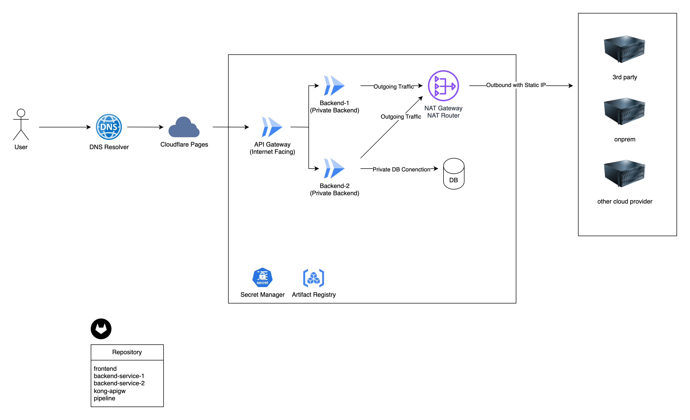
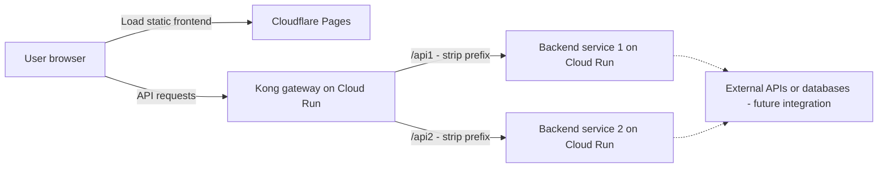
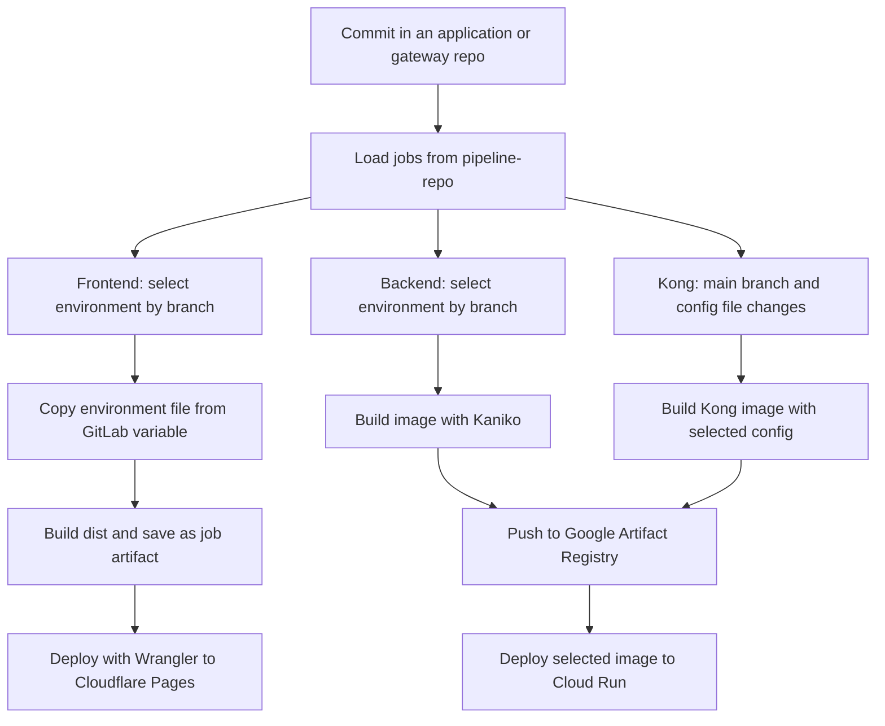

# Architecture and CI/CD Pipeline Design

This project demonstrates a web application split across several repositories, with GitLab CI/CD, Cloudflare Pages for the frontend, and Google Cloud Run for the backend services and Kong API gateway.

`example_org_repo/` simulates an organization with multiple independent Git repositories. They are collected in one directory here so the design is easy to review. In a real setup, each `*-repo` directory would be its own GitLab project, with its own history, permissions, and releases.

## Repository layout

```text
example_org_repo/
├── frontend-repo/           # Frontend source and a CI include
├── backend-service-1-repo/  # First backend service and a CI include
├── backend-service-2-repo/  # Second backend service and a CI include
├── kong-repo/               # Gateway image, routes, and environment configs
├── pipeline-repo/           # Actual CI/CD job definitions for these repos
│   ├── frontend-repo/.gitlab-ci.yml
│   ├── backend-service-1-repo/.gitlab-ci.yml
│   ├── backend-service-2-repo/.gitlab-ci.yml
│   └── kong-repo/.gitlab-ci.yml
└── backend-artifact-repo/   # Optional private artifact repository placeholder
```

| Repository | Responsibility | Deployment target |
| --- | --- | --- |
| `frontend-repo` | React, TypeScript, and Vite frontend; builds static files into `dist/` | Cloudflare Pages |
| `backend-service-1-repo` | Independent Go HTTP service with its own Dockerfile | Cloud Run |
| `backend-service-2-repo` | Second independent Go HTTP service with its own Dockerfile | Cloud Run |
| `kong-repo` | DB-less Kong gateway, `/api1` and `/api2` routes, and per-environment configuration | Cloud Run |
| `pipeline-repo` | Central location for build and deployment jobs | Included by the application and gateway pipelines |
| `backend-artifact-repo` | Placeholder for private backend artifacts if needed | No implementation yet |

The two backends currently contain the same minimal example: `GET /` returns `Hello, World!`, and `GET /health` returns a healthy status. They illustrate separately deployable services. Container images are pushed to Google Artifact Registry; the optional `backend-artifact-repo` folder is not used by those jobs.

## Application architecture



[View full-size diagram](coraline-2-architect.png) · [Editable draw.io source](coraline-2-architect.drawio)

The overview includes planned infrastructure and external integrations. The simplified request flow below focuses on the application services.



The browser loads the frontend from Pages and sends API requests to Kong. Kong selects the backend using the URL path and removes the route prefix before forwarding the request. For example, `/api1/health` reaches `/health` on service 1.

Kong runs without a database. Its Dockerfile copies one of `kong.dev.yml`, `kong.uat.yml`, or `kong.prod.yml` into the image using the `KONG_CONFIG` build argument. Each configuration contains the upstream URLs for that environment.

This diagram describes the intended integration. The current frontend is an invitation/reservation demo that calls `/api/reserve`; neither example backend implements that endpoint. Connecting the demo end to end requires matching frontend requests, gateway routes, and backend handlers.

## How the pipeline repository works

Each application repository keeps a small `.gitlab-ci.yml` that includes its matching configuration from the central GitLab project. For example, service 1 contains:

```yaml
include:
  - project: 'myorg/pipeline-repo'
    file: 'backend-service-1-repo/.gitlab-ci.yml'
```

`myorg/pipeline-repo` represents the separate GitLab project that holds the contents of the local `pipeline-repo/` directory. Replace it with the real group and project path when creating the repositories.

The included jobs run in the consuming repository's pipeline and build that repository's source and Dockerfile. The pipeline repository stores the job definitions; it does not check out and deploy every service as one combined release. Each service can be released independently.

The includes currently omit `ref`. Pinning them to a reviewed tag or commit would let each repository control when it adopts pipeline changes. Updating the central configuration alone does not trigger a release in every consuming repository.

## Environments

Application pipelines accept only `develop`, `uat`, and `main` branches. UAT serves as the staging environment in this example.

| Application branch | Frontend environment | Backend environment / service suffix | GCP project |
| --- | --- | --- | --- |
| `develop` | `dev` | `develop` | `example-project-nonprod` |
| `uat` | `uat` | `uat` | `example-project-nonprod` |
| `main` | `prod` | `prod` | `example-project-prod` |

Development and UAT share a nonproduction GCP project but use separate Cloud Run service names. Production uses a separate project and deployment credential. The frontend design uses a separate Pages project per environment.

Kong uses only the `main` branch. Its intended environment selection is based on the changed configuration file: `kong.dev.yml`, `kong.uat.yml`, or `kong.prod.yml`. Its development service suffix is also `develop`.

## CI/CD flow



### Frontend

1. Select the environment from the branch.
2. Install dependencies and copy the matching GitLab file variable (`FE_DOTENV_DEV`, `FE_DOTENV_UAT`, or `FE_DOTENV_PROD`) to `.env`.
3. Run the Vite build and retain `dist/` as an artifact for one week.
4. Use Wrangler to create the environment's Pages project if needed and deploy the artifact. Each separate Pages project uses `main` as its production branch.

The frontend Dockerfile runs a development server; this deployment pipeline builds static assets directly and does not use that Dockerfile.

### Backend services

1. Select the environment, GCP project, and deployment service account key.
2. Build the repository's Dockerfile with Kaniko.
3. Push the image with both a commit short-SHA tag and an environment alias such as `uat-latest`.
4. Deploy the commit-tagged image to `<service-name>-<environment>` on Cloud Run.

Both backend repositories have their own pipeline definition and image repository. Current jobs contain build and deploy stages only; tests and security scanning are not wired into CI.

### Kong gateway

1. On `main`, select an environment from the changed Kong configuration file.
2. Build the gateway image with the selected `KONG_CONFIG`.
3. Push tags `<environment>-<commit-sha>` and `<environment>-latest`.
4. Deploy the commit-tagged image to `kong-api-gw-<environment>`.

The templates also define manual fallback jobs. Automatic file-change selection needs the correction listed below, and `deploy-prod` is currently disabled explicitly.

## Configuration and deployment setup

The examples assume cloud resources and GitLab settings are prepared separately. There is no infrastructure provisioning pipeline or Terraform configuration in this directory.

| Setting | Used for |
| --- | --- |
| `FE_DOTENV_DEV`, `FE_DOTENV_UAT`, `FE_DOTENV_PROD` | GitLab **file** variables containing frontend build configuration |
| `CLOUDFLARE_ACCOUNT_ID`, `CLOUDFLARE_API_TOKEN` | Pages deployment |
| `GCP_NONPROD_SA_KEY`, `GCP_PROD_SA_KEY` | JSON service account key values used by the current build/deploy scripts |
| `GCP_REGION` | Cloud Run deployment region; image paths currently hard-code `asia-southeast1` |
| Runner tag `project-builder-tag` | Selects the GitLab runners for these jobs |

Replace the example GCP project IDs and Kong upstream URLs. Prepare Artifact Registry repositories, deployment permissions, runtime service accounts, and Cloud Run settings. The Go services listen on port `3000`; Kong's proxy listens on `8000`. The deploy commands do not configure these ports, ingress, runtime identity, or health probes.

Frontend `VITE_*` values become part of the browser bundle and must contain only public configuration, such as the gateway URL. Keep deployment credentials in restricted GitLab variables. Backend runtime secrets and external database credentials are not implemented here; the intended extension is environment-specific Secret Manager references and separate runtime identities.

The Kong image includes a `gcp-id-token` plugin for authenticated calls to private Cloud Run services, but none of the supplied route configurations enables it. Those configurations currently assume unauthenticated backend invocation. A private-backend setup would also need plugin configuration with the correct audience and permission for Kong's runtime identity to invoke each backend. Browser authentication and cross-origin API access still need application/gateway configuration.

## Release and operations design

The current application release flow is branch-based: validate changes in `develop`, merge into `uat` for acceptance testing, then merge into `main` for production. Each branch builds again; the sample does not promote one identical image through all environments. Production backend and frontend jobs have no manual approval gate in these YAML files.

For a fuller implementation, add protected branches and production approvals, automated tests before deployment, smoke checks after deployment, and a recorded image digest for each backend/gateway release. Rollback would redeploy a known-good image or restore traffic to a prior Cloud Run revision; frontend rollback would restore a known-good Pages deployment. These rollback steps are not automated here.

The backends expose `/health`, and Kong writes access/error logs to stdout/stderr. Cloud Run health probes, centralized dashboards, alerts for errors and latency, and incident procedures still need configuration. Infrastructure changes should have a separate reviewed provisioning workflow for nonproduction and production resources.

The original scenario also mentions background workflows and external data sources. This sample has no Airflow deployment, worker service, database, or private network connection. Those would be additional components with their own deployment lifecycle, secrets, and connectivity configuration.

## Known gaps in the sample

These are findings from the current files, not changes made by this README:

- **Kong include path:** `kong-repo/.gitlab-ci.yml` references `kong-apigw-gw/.gitlab-ci.yml`, but the supplied template is `pipeline-repo/kong-repo/.gitlab-ci.yml`.
- **Kong change rules:** the rules use `CI_PIPESOURCE` instead of `CI_PIPELINE_SOURCE`, so normal push pipelines do not match the intended automatic deployment rules unless that custom variable is supplied.
- **Kong production:** `deploy-prod` uses `when: never`. Production deployment must be deliberately enabled to complete that release flow.
- **Shared Kong changes:** change rules watch only environment YAML files. Dockerfile and plugin changes need to trigger the affected environment builds as well.
- **Frontend dependency install:** CI uses `pnpm install --frozen-lockfile`, but the repository supplies `package-lock.json` and no `pnpm-lock.yaml`. Align the package manager and lockfile.
- **Pages project name:** the deploy job uses `${CI_PROJECT_DIR}-${ENV_NAME}`, which contains a filesystem path. Replace it with a suitable project name, for example `${CI_PROJECT_NAME}-${ENV_NAME}` with naming validated for Pages.
- **Development naming:** the backend pipeline deploys `*-develop`, while `kong.dev.yml` contains placeholder `*-dev` URLs. Set the actual deployed service URLs consistently.
- **End-to-end integration:** the frontend reservation API, Kong routes, and minimal Go handlers do not yet form a working reservation flow.

See [scenario.txt](scenario.txt) for the original requirements and [Flow-CICD.txt](Flow-CICD.txt) for the initial pipeline notes. The notes describe the intent; the details above reflect the supplied code and CI files.
